Wren is a web browser written in Odin in which WebAssembly is the only execution engine. A page can be written in plain JavaScript or directly in Wasm, and both run inside the same sandbox, under the same limits, against the same DOM. There is no native JavaScript engine in the process: the engine itself is a Wasm module.

This post is the long version of the README: an identity card, the architecture seen from far away and from very close, the parts that make Wren unusual, how it is tested, and an honest list of what it cannot do yet. Every diagram below can be opened in a viewer: click it (or the *expand* button) to pan, zoom, pinch and go full screen.

## Identity card

| Field | Value |
|---|---|
| **Name** | Wren |
| **One line** | A small web browser where WebAssembly runs everything, JavaScript included |
| **Status** | Beta, version 0.6.24 (2026-11-01). A research project, not a daily browser |
| **Author** | Sacha Froment |
| **First commit** | 2026-10-18; about 2,000 commits and 31 tagged releases since |
| **Languages** | Odin (about 406,000 lines in `src/`), Rust (about 22,500 lines: network, decoders, text, GPU process), a thin layer of C shims over Lexbor, Go for the test server |
| **Platforms** | Windows 10 and 11, x64, one self-contained exe. Linux x86-64 as an early preview (glibc 2.39 or later) |
| **Execution engine** | [Wasmtime](https://wasmtime.dev) 49 (Cranelift, or Winch), statically linked |
| **JavaScript** | An engine written in Odin that runs QuickJS-ng 0.17 bytecode, compiled to Wasm; 99.92 % of test262 |
| **HTML, CSS, layout** | Lexbor for parsing; its own cascade, shadow DOM, block, inline, flex, grid, table and multi-column layout |
| **Painting** | A retained GPU compositor on Direct3D 11, text shaped by Fontations, HarfRust and ICU4X |
| **Network** | HTTP/1.1, HTTP/2, HTTP/3 and WebSockets on hyper, rustls, quinn and tungstenite |
| **UI toolkit** | [gui_toolkit](https://github.com/sachahjkl/gui_toolkit), an immediate-mode toolkit by the same author |
| **Web API** | 53 modules, 1,355 functions, described once in a Web IDL dialect; everything else is generated |
| **Conformance** | 99.92 % of test262; more than 130,000 web-platform-tests subtests pass in 48 folders |
| **Licence** | Source-available, [PolyForm Strict 1.0.0](https://polyformproject.org/licenses/strict/1.0.0/): free to read and to use for noncommercial purposes, not to redistribute or modify |
| **Where** | [github.com/sachahjkl/wren](https://github.com/sachahjkl/wren), site at [sachahjkl.github.io/wren](https://sachahjkl.github.io/wren/) |

## The bet

Most browsers run three kinds of code side by side: the engine's own native code, JavaScript in a JIT, and WebAssembly in another tier. Each has its own memory model, its own limits, its own way to fail. Wren makes a different bet:

1. **One execution engine, and it is a sandbox.** Everything a page runs, JavaScript included, is a WebAssembly instance in Wasmtime. The limits are the same for every guest: a memory cap, a wall-clock deadline on every host-to-guest call, no way to reach the host's memory except through generated, checked imports.
2. **The browser is the operating system of those guests.** The DOM, events, timers, fetch, storage and workers are Wasm imports. They are described once, in `api/*.widl`, and a generator writes the host side, the guest SDK, the documentation and the conformance tests.
3. **JavaScript is just another guest.** The engine is a module with its own heap, one instance per page and per worker. If it traps, that page loses its scripts (the status bar says `JS stopped`), never the browser.

The price is speed: JavaScript is interpreted, with a JIT for numeric loops only, and a DOM call crosses the Wasm boundary. The reward is a design where "what can this page do to the browser?" has a short and checkable answer.

## A first look

The window, its tabs and its pages are all drawn by Wren itself. These are real screenshots, all taken in one pass by a script (`wrentool shots`). They come from Wren 0.6.1; later versions changed some of what they show, the start page above all.


## The macro view

### The layers

Seen from far away, Wren is a shell around documents. Each document is a DOM plus the guests that act on it. Services (network policy, blocker, decoders, media) sit under the documents, and Wasmtime sits under every guest.

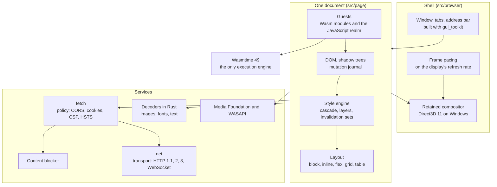

The directory layout mirrors the picture. The biggest packages are `page` (the glue between a document, its guests, its requests and its timers), `browser` (the shell), `engine` (the JavaScript engine), `style` and `layout`.

### One ownership tree

The first rule of the architecture is that **everything a page starts is registered in its scope**. A scope is a node of one tree, and closing a tab or navigating is one `scope_close`. Cleanups run newest first, children before parents, so nothing outlives what it points to.

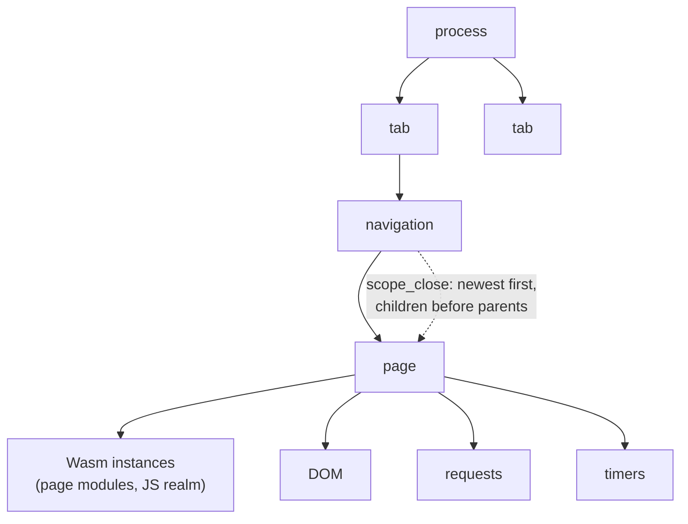

The second rule is how objects point to each other: **handles, never pointers, cross boundaries.** A handle is `generation << 32 | index`, and 0 is invalid. A destroyed or recycled slot fails to resolve, so a late network event, a timer or a listener callback for a dead object is dropped instead of being delivered to reused memory. Pool objects live in chunks and never move, so a pointer stays valid until the object is removed.

### One thread talks to the user

The third rule: **a single UI thread, and everything else posts.** The network threads, the image decoders, the style and layout threads and the blocking pool only push events and post back to the loop. Every user-visible callback runs on the loop thread. A page's DOM and its Wasm instances live on that thread; workers have their own store.

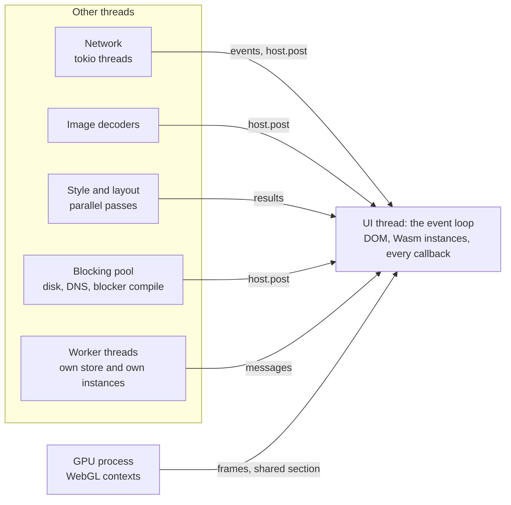

The rules continue: the network layer is *mechanism* and `fetch` is *policy* (see below); every limit is bounded and tunable in `about:config`; the guest cannot reach host memory; and destruction, text extraction, searches and the HTML replay are iterative, so hostile depth cannot blow the stack. The whole list is in [docs/architecture.md](https://github.com/sachahjkl/wren/blob/master/docs/architecture.md).

## The micro view

Now we zoom in on the parts where Wren does something unusual.

### A call from a Wasm guest into the DOM

Every import of the browser is a generated trampoline defined directly on the Wasmtime linker. Before any of the browser's code runs, the trampoline has validated everything the guest handed over.

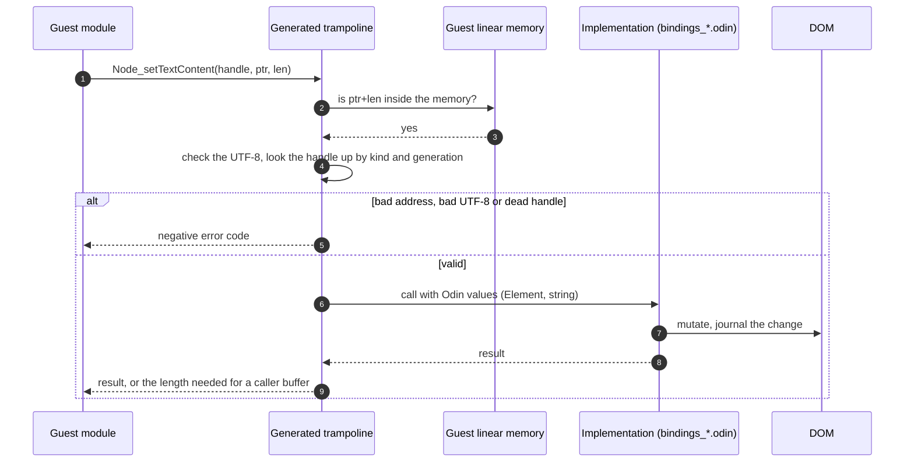

The conventions are small: handles are `i64`, strings are UTF-8 `(pointer, length)`, strings the browser returns go into a caller-provided buffer (the result is the length needed), callbacks are function-table indices with a user value, and errors are negative `i32`. A page is any module that imports those functions and exports `wb_main`; here is the whole Odin counter of the screenshot above:

```odin
package counter

import "web:web"

count: i64
count_node: web.Element

on_click :: proc "contextless" (user: i32, ev: web.Event) {
	count += i64(user)
	buf: [24]u8
	n := len(buf)
	for v := count; ; v /= 10 { n -= 1; buf[n] = u8('0' + v % 10); if v < 10 { break } }
	web.Node_setTextContent(count_node, string(buf[n:]))
}

@(export)
wb_main :: proc "contextless" () {
	count_node = web.Document_getElementById("count")
	web.EventTarget_addEventListener(web.Document_getElementById("inc"), "click", on_click, 1)
	web.console_log("counter ready")
}
```

### One description, everything generated

Adding a web API starts as a few lines in `api/<module>.widl`. The generator, `bindgen`, is deterministic, and `test_all` fails when a generated file is out of date.

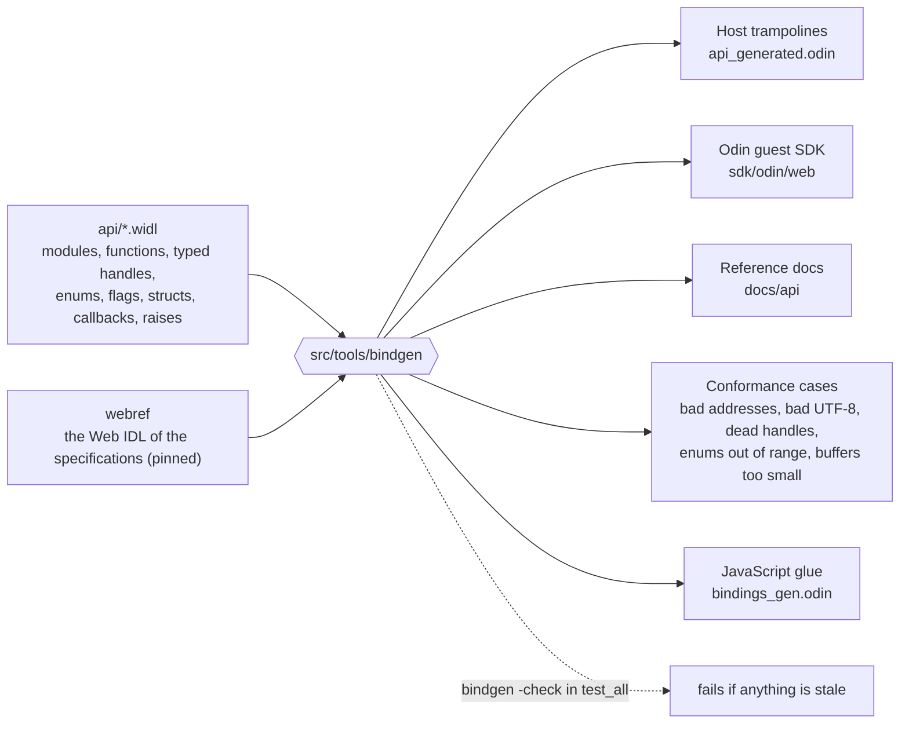

The expected prototype of each implementation is written above its trampoline, so a missing or mistyped implementation does not compile: the compiler tells you which host procedure to write. For the JavaScript side, `3,798` of the `5,308` members of the specifications' Web IDL are implemented (about 72 %). A member that is not implemented is absent, so feature detection (`"ResizeObserver" in window`) tells the truth.

## JavaScript, inside WebAssembly

This is the part that gives Wren its tagline. The engine lives in `src/engine`, and it is itself written in Odin.

### What the engine is made of

| Piece | Role |
|---|---|
| `frontend` | Compiles JavaScript source to **QuickJS-ng 0.17 bytecode** |
| `jsrt` | The runtime: a switch-dispatch interpreter, a precise mark-and-sweep GC, shapes and atoms, the standard library, a loop JIT |
| `jscapi` | The QuickJS C API (167 procedures) implemented over `jsrt`, so that the glue can be written against `quickjs.h` |
| `native/js` | The glue: the web platform's objects as native functions wired to the browser's `wr_*` imports |

The front end and the reference QuickJS C compiler emit the same serialized bytecode, and the runtime reads and runs it. A verifier checks the stack height of every function after reading. The engine is not a mechanical port: values are a 16-byte tagged union instead of NaN-boxing, the GC traces instead of counting references, strings are ropes with Latin-1 and UTF-16 compaction, and opcode and atom tables are generated at compile time.

### From Odin to a Wasm image

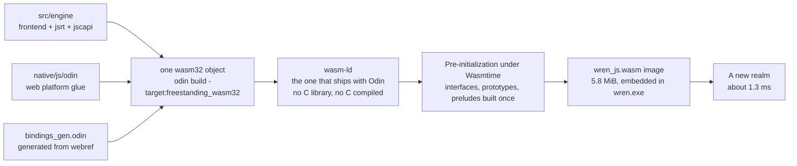

Because the interfaces and prototypes of the web platform are already built in the image, a new realm starts in about 1.3 ms. Web IDL prototypes are *lazy*: a realm creates the function objects of the interfaces a script actually looks at, not the thousands of all of them. Each page and each JavaScript worker gets its own instance, so a trap loses that realm only.

### A JIT that compiles to WebAssembly

The interpreter is a plain bytecode loop with a hot path written with raw pointers. On top of it sits a **loop JIT** whose output is... WebAssembly, compiled by Cranelift, living in the same sandbox as the engine. It only compiles numeric loops: locals and operand-stack entries used as numbers become Wasm locals (`i32` for ints, `f64` for doubles), and anything it cannot do inline keeps the loop from being compiled at all.

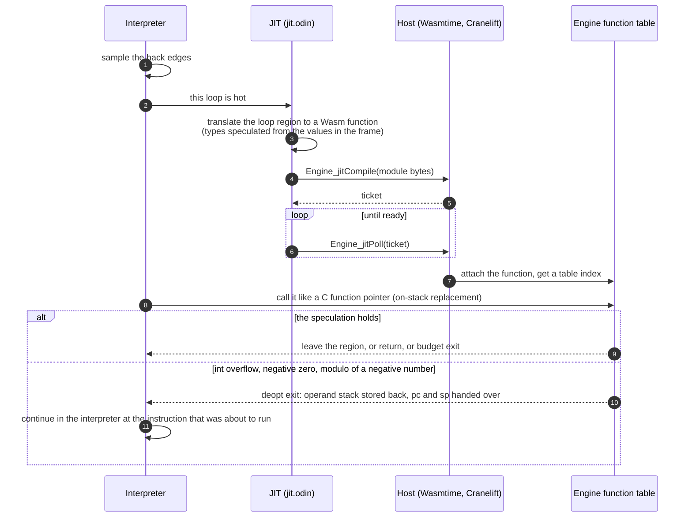

Every 16,384 iterations the compiled loop exits so that the interpreter's safe point (interrupt, GC) still runs. After 16 deopts a loop is not compiled again.

### Honest numbers

Measured on Windows x64 against QuickJS-ng 0.17 built with Zig at `-O2`:

| Benchmark | Wren's `jsrt` | QuickJS-ng |
|---|---:|---:|
| `micro.js`, geometric mean of 20 cases | 100 % (it was 68 %) | 100 % |
| `macro.js`, 28 cases (JSON, regexp, strings, Map and Set, classes, generators) | 119 % | 100 % |
| best and worst micro cases | `for-of` 233 %, `switch` 62 % | |
| peak memory, 300k objects and 100k Map entries | 188 MiB | 135 MiB |
| test262, native judge | 99.92 % (43,233 of 43,267) | the same 34 failures |

Speed is at parity with QuickJS on the micro benchmarks, which is *interpreter* speed: far slower than a browser with a method JIT on script-heavy pages. The slow cases are the ones that pay one dispatch per bytecode, native-to-JS callbacks (`sort` comparators, `forEach`), and destructuring. The 34 test262 failures are exactly the ones QuickJS-ng itself fails.

### Frames: two heaps that behave like one

Each document has its own realm and its own heap, but pages expect `iframe.contentDocument.write(html)`, `parent.foo()` and `frame.contentWindow.someGlobal` to work between documents of the same origin. Wren gets that without sharing a heap.

**Nodes** are handles that name their document: 15 bits of the generation word are the document's tag. A handle given to the wrong document fails like a dead one, in any implementation.

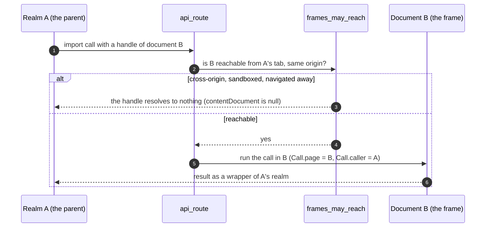

**Globals** cross through a value bridge: primitives are copied, DOM nodes become the other realm's wrapper, windows become its `WindowProxy`, and any other object or function becomes a `Proxy` that forwards `get`, `set`, `has`, `delete`, `keys`, `call` and `construct`. The origin is checked at each request. It is not one heap, and the docs list what that costs (for example, built-ins read from another window are the caller's own, so `frame.contentWindow.Array === Array`).

## From DOM mutation to pixels

DOM mutations and style changes are journaled. A frame runs only what is needed: a style pass (full, in parallel on large documents, or a partial restyle from invalidation sets), a layout pass (refresh, incremental or full), the display list, then the compositor.

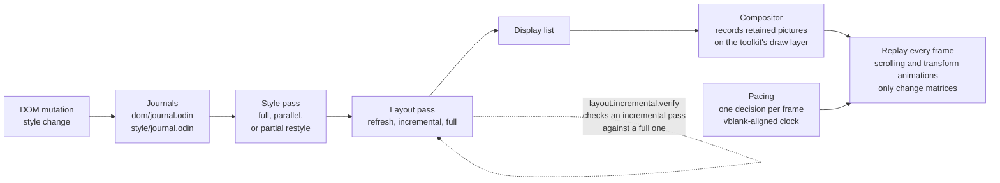

Some particularities of that pipeline:

- **Draws only when something changes.** An idle page costs no frames.
- **Pacing on the display's exact refresh rate** (60 to 180 Hz and beyond), with a vblank-aligned animation clock, smooth scrolling and one frame in flight. A status bar shows a live frame graph.
- **Shaders are precompiled:** the first frame of the start page is drawn about 0.3 s after launch (1.8 s before).
- **Colour handling as browsers do it:** colours blended on sRGB values, Chromium's text contrast settings, gamma-correct where it should be, ICC profiles and CICP through qcms.
- **Text on Fontations, HarfRust and ICU4X**, the same on every machine: per-character fallback, OpenType shaping, bidi, synthetic italics, and colour fonts in every format (COLRv1, sbix, CBDT, OT-SVG).
- **Effects:** transforms, rounded clips, opacity groups, `filter`, `backdrop-filter`, `mix-blend-mode`, `clip-path`, exact gaussian box shadows in the shader, every kind of gradient, masks and `background-clip: text`.

## Network: mechanism and policy are separate

The transport, `net`, moves bytes. It never follows a redirect, stores a cookie or sends ambient credentials. `fetch` decides, hop by hop, on the UI thread, with the document's environment in hand. A guest, a module load and a navigation all go through the same code, so there is exactly one place where "may this request happen?" is answered.

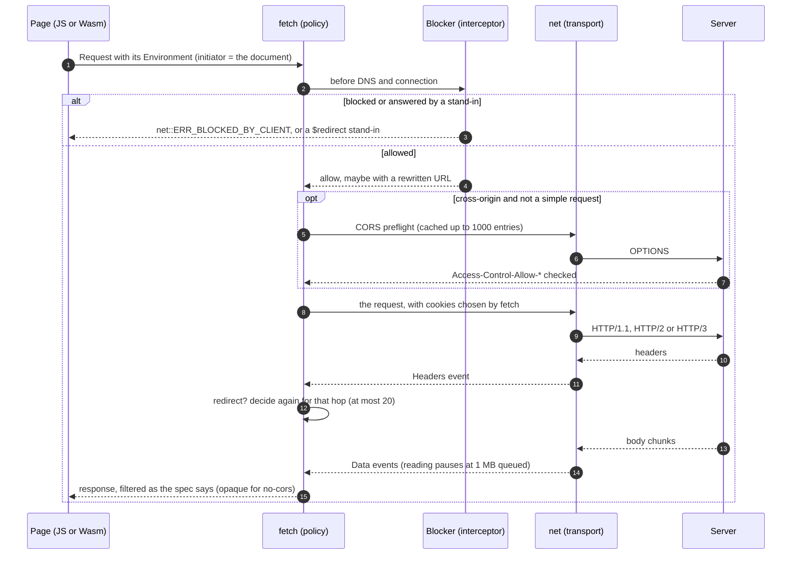

The transport is a Rust stack the same on every platform (hyper, rustls with the system's trust store, quinn for HTTP/3 on origins that announce it, tungstenite for WebSockets), with the system proxy including CONNECT tunnels. WinHTTP stays selectable as a backend. Errors keep WinHTTP's numbers whichever stack ran the request.

### The security model in a table

| Concern | What Wren does |
|---|---|
| Origins | `scheme://host:port` or an opaque origin; sites from the Public Suffix List |
| Requests | Carry an Environment: modes `navigate`, `same-origin`, `no-cors`, `cors` |
| CORS | Origin header, ACAO and ACAC checks, header exposure filtering, preflights with the spec's rules, preflight cache with max-age |
| Cookies | Stored and sent only by `fetch`; `Secure`, `__Host-` and `__Secure-` prefixes, `SameSite` (Lax by default); third-party cookies **blocked by default** |
| Transport policy | HSTS, referrer policy, mixed content blocking, bad ports, Fetch Metadata (`Sec-Fetch-*`) |
| CSP | Level 3, headers and `<meta>`, report-only; `script-src` governs Wasm modules too, `worker-src` workers |
| Cross-origin isolation | COOP, COEP and CORP enforced; `SharedArrayBuffer` and Wasm threads only under isolation |
| Local files | A `file:` page may read its own directory tree and nothing else; web pages never read local files |
| Storage | Partitioned by top-level site, with the Storage Access API |
| Passkeys | Web Authentication Level 3, through Windows Hello, security keys and the passkey managers Windows knows |

## Things that make Wren peculiar

### A content blocker built into the loader

Advertising, tracking and malware are stopped before the request leaves the machine, in a few microseconds each. A filter engine in Odin reads the Adblock Plus, uBlock Origin and AdGuard syntaxes, compiles lists into one binary index that loads in about 13 ms, and matches without allocating per request. Regular expressions run on a Pike VM (linear time, no catastrophic backtracking).

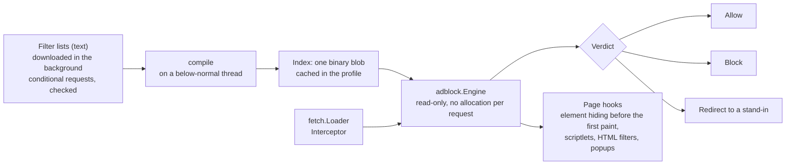

The lists are downloaded, never shipped (the only built-in list is a small one written for Wren), and nothing is reported anywhere. The interface is native: a shield at the end of the address bar with its panel and a dashboard at `about:blocker`.

### WebGL in a process of its own

WebGL and WebGL 2 are drawn through wgpu in a **GPU process**, started by the first context of the browser, with lowered rights, that ends with its parent. Calls are written to a command buffer and sent at the end of the task or when the page has to wait for an answer, so a frame of a thousand draws is one host call.

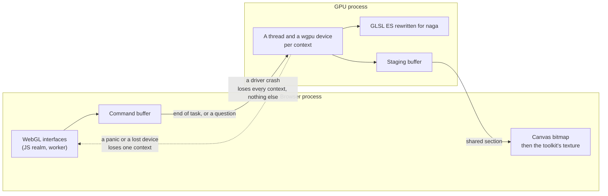

A crash or a hang in a driver costs contexts (`webglcontextlost`, then `webglcontextrestored` from a new process), never the browser. Three.js examples and MapLibre GL JS work; `docs/js/webgl.md` lists what GL has and wgpu has not, and what stands in for each.

### Crashes that do not loop

After an abnormal end, the next start reopens the tabs, with no setting to turn on, and **never loops on a page that crashes it**. A marker file records that Wren runs and whether this run is itself a restore. If a restored session ends within 30 seconds, the next start refuses to restore it again and keeps the tabs in a backup file.

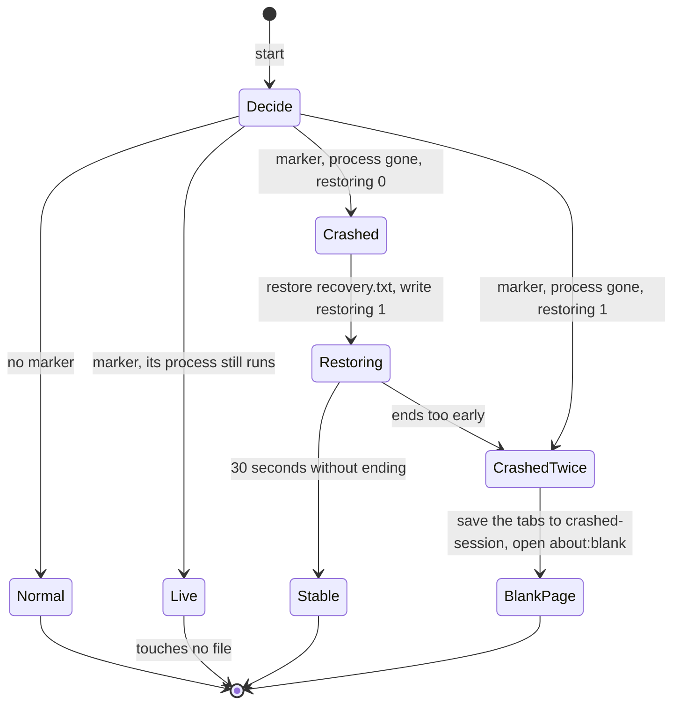

The snapshot is written atomically by a worker of the blocking pool, at most every 3 seconds and only when something changed. The tests kill real processes to check each transition.

### Smaller things worth knowing

- **Everything is a preference.** Every subsystem declares its settings (type, bounds, unit, description), layered *defaults, profile file, command line (`--pref name=value`), policy file*, and edited live in `about:config`. A test checks that every table is well formed.
- **Workers and shared memory.** Dedicated, shared and service workers; under cross-origin isolation a page and its workers share memory with `Atomics.wait` and `Atomics.notify` working across JavaScript and Wasm, without building the JS engine image with threads.
- **Media.** MP4 and WebM with H.264, HEVC and AAC through Media Foundation, AV1 and VP9 in software when needed, Opus, Vorbis, FLAC, MP3; the picture stays in video memory and is drawn like an image; Media Source Extensions for adaptive streaming.
- **Web Audio**, with a graph rendered in the browser on a thread per running context, and **WebCodecs decoders**.
- **IndexedDB, Cache API, service workers, `crypto.subtle`** (a real one: keys stay in the browser), Web Animations, the Popover API, CSS anchor positioning, multi-column layout and vertical writing modes.
- **Accessibility** through UI Automation (AccessKit), updated at most ten times a second for pages that change every frame, and a screen reader's request is still answered at once.
- **Several windows**, tabs in the title bar or in a sidebar with groups and pinned tabs, downloads, find in page, page zoom, session restore.
- **Error pages by cause** (DNS, refused, timeout, TLS, missing file), and `view-source:`.

## Driving it from outside

Wren can be controlled from a script without a window and without a desktop. `wren ctl` is a sub-command of `wren.exe` itself, so client and server always speak the same protocol version.

```powershell
wren ctl run --size 1280x800 --shot out.png https://example.com/
```

One call starts a browser, loads the page, captures the window and closes it in about 0.5 s (process start 55 ms, first frame and load 215 ms, capture 70 ms, close 110 ms), against 2 to 3 s for starting a browser, sleeping and capturing the screen. For standard tools, an adapter speaks **CDP** and **WebDriver BiDi** over a local WebSocket (loopback only) so that Puppeteer, Playwright and Chrome DevTools can connect; it is off by default and translates onto the same command engine as `wren ctl`, so there is one control path, not two.

## How it is tested

The test runner, `test_all`, is an Odin program. Its steps are a typed table and a run is a small state machine; it runs steps in parallel on a Windows desktop of its own so that no step can take your mouse or keyboard.

| Layer | What it does |
|---|---|
| Unit tests | Every package, with `-vet`; every test fails on a leak or a bad free |
| Generated checks | Bindings are up to date (`bindgen -check`); generated API conformance cases for every function |
| End to end | Real pages, Wasm guests and scripts driven against a local test server: network policy, DOM and events, forms, workers, WebSocket, images, local files, the JS engine and its web APIs |
| test262 | The ECMAScript suite against the engine compiled to Wasm, pinned by commit: 99.92 % of 82,220 runs (what fails: `Atomics.pause` and growable `SharedArrayBuffer`, which need threads that WASI does not have) |
| web-platform-tests | 48 folders at a pinned commit, with expectations committed per subtest: more than 130,000 subtests pass, and any regression fails the run |
| Reference tests | Pixel comparisons in the multi-column and writing-modes folders, on a software rasteriser written for the purpose |
| Memory | Every allocation of the process goes through one tracker; a tool fails when anything is still allocated after shutdown. A check build and an AddressSanitizer build run whole sessions |
| Endurance | 400 tabs and 2,000 navigations: tracked bytes, private bytes and the kernel, GDI and USER handles must stop growing |

Two details are worth stealing. First, **a result is found by content, never by time**: with `-Quick`, a step that already passed with exactly the same inputs says `CACHED`, and the key is a hash of the step's commands, every file of the packages it compiles and of everything they import, and what they load or read. Second, **tests check properties, never wall-clock durations**, so a loaded CI machine does not make them flaky.

The conformance page of the documentation is honest about its numbers: Wren measures a handful of WPT folders, so its totals are not comparable with the per-browser scores on wpt.fyi. A high percentage means "the part Wren claims to do, it does", not "as complete as another browser".

## The numbers

Wren is young. The first commit is from 2026-10-18; at the time of writing there are about 2,000 commits and 31 tagged releases, from 0.1.0 on 2026-10-19 to 0.6.24 on 2026-11-01.

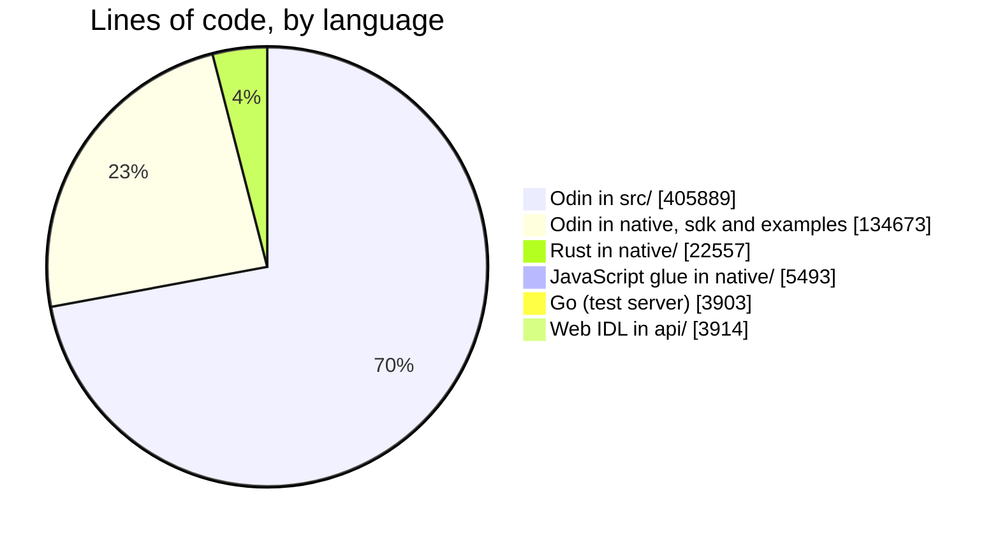

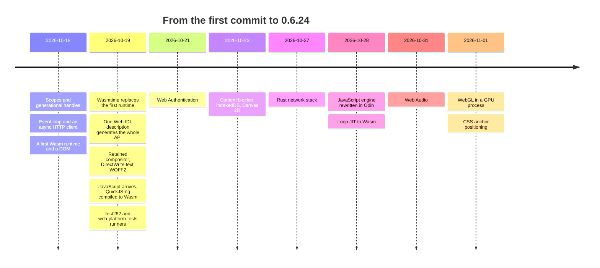

The engine rewrite is the part that surprises people the most: the first JavaScript engine was QuickJS-ng built with Zig to a WASI module and pre-initialized at build time. Nine days later, the whole engine (front end, interpreter, GC, standard library, regexp, Unicode, dates, BigInt) existed in Odin, passing the same test262 tests, and the Zig dependency was gone. That is possible because the engine's contract with the rest of the browser was a C API and a bytecode format, not a code base.

## What Wren cannot do

The README keeps a list, and so does this post:

- **JavaScript is interpreted**, with a JIT for numeric loops only: far slower than Edge on script-heavy benchmarks, and a DOM call crosses the Wasm boundary.
- **Each document has its own heap**, so frames are a bridge of proxies, not one heap, with the edge cases listed above.
- **Part of the web platform is missing:** about 72 % of the members of the specifications' Web IDL. No WebGPU, no WebRTC, no video or audio encoder in WebCodecs, Canvas 2D is software-drawn, and `Intl` follows English conventions whatever the locale.
- **No HTTP authentication**, no IME composition, no Encrypted Media Extensions, and CSP violations are reported to the console only.
- **Linux is newer than Windows:** releases for Linux x86-64 need glibc 2.39 or later.
- **It is a beta.** Real sites run (the changelog is a long list of fixes found on real sites), but this is a research project meant to show how far a browser with a single, sandboxed execution engine can go, not to replace one.

## Try it, read it

- Download `wren-<version>-windows-x64.exe` from the [latest release](https://github.com/sachahjkl/wren/releases/latest) and run it. It is one file, it needs Windows 10 or 11 with a Direct3D 11 GPU, and nothing else to install. `about:demos` lists every demo and test page.
- On Linux, download the `tar.gz`, or run `nix run github:sachahjkl/wren`.
- To build it: `git clone --recurse-submodules`, then `build.bat`. The build fetches Wasmtime (SHA-256 pinned), compiles Lexbor and the one Rust library, regenerates the bindings, builds the JavaScript module and links one self-contained `wren.exe`.
- The best entry points in the repository are `docs/architecture.md`, `docs/engine/runtime.md`, `docs/js/webgl.md` and `docs/testing.md`.

Wren's source is public under the PolyForm Strict License 1.0.0, and it stands on a lot of other people's work: Odin, Wasmtime, QuickJS-ng, webref, Lexbor, resvg, rav1d, hyper, rustls, quinn, Fontations, HarfRust, ICU4X, AccessKit, the Public Suffix List and the test suites test262 and web-platform-tests. The README lists every one of them.
